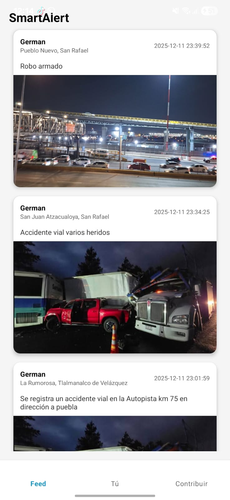
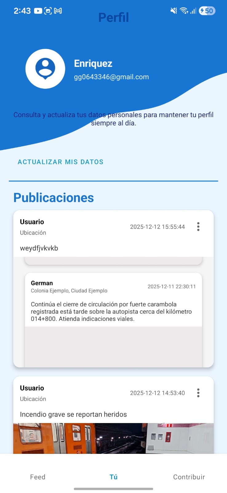

# Smart Alert — App móvil (Frontend)

Aplicación móvil Android para que la ciudadanía **reporte y consulte incidentes viales y zonas de riesgo** en un mapa interactivo y en un feed de reportes. Cada reporte pasa por un flujo de moderación antes de publicarse, para filtrar contenido sensible o malintencionado.

> Proyecto académico en equipo — Ingeniería en Sistemas Computacionales, Tecnológico de Estudios Superiores de Chalco.

## Capturas

<!-- Agrega aquí 3 o 4 capturas: mapa, feed, perfil, nuevo reporte -->
| Feed de reportes | Perfil |
|---|---|
| |  |

---
## Funcionalidades

- **Mapa interactivo** con incidentes viales y zonas de riesgo.
- **Feed de reportes** con los incidentes publicados.
- **Perfil personal** del usuario.
- **Creación de reportes** que se envían a moderación antes de publicarse.
- Consumo de la **API REST** del backend (Laravel).

## Tecnologías

| Capa | Tecnología |
|---|---|
| Lenguaje | Kotlin |
| IDE | Android Studio |
| Comunicación con backend | API REST (JSON) |
| Backend (repo aparte) | Laravel + MySQL |

## Requisitos

- Android Studio (versión reciente)
- JDK 17 o superior
- Emulador o dispositivo físico con Android
- Backend de Smart Alert en ejecución (ver [repositorio del backend](https://github.com/genriquez8080-pixel/smartalert-backend))

## Estado del proyecto

Proyecto académico presentado en exposición escolar. Posibles mejoras futuras:

- Notificaciones push por zonas de riesgo cercanas
- Filtros de reportes por tipo de incidente y distancia
- Pruebas automatizadas de interfaz

## Licencia

[Uso académico]
